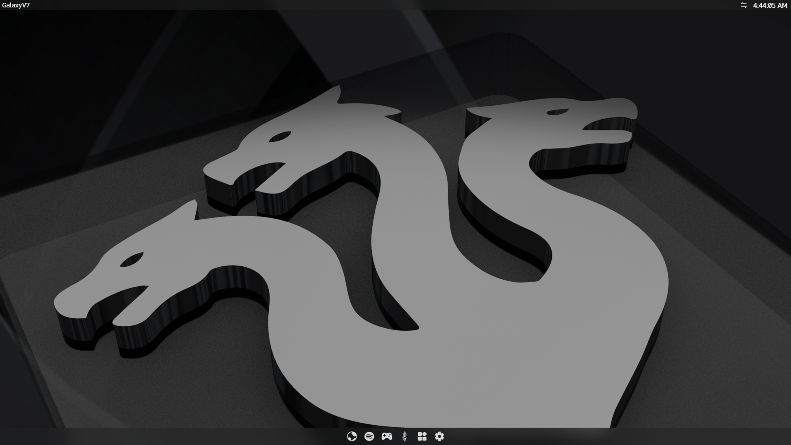
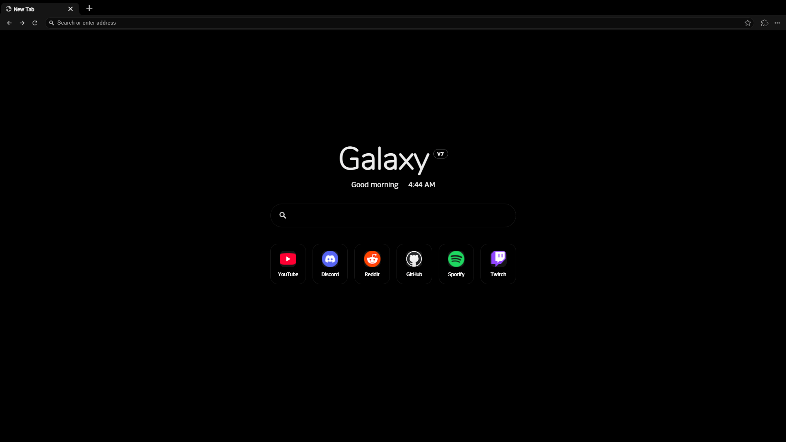
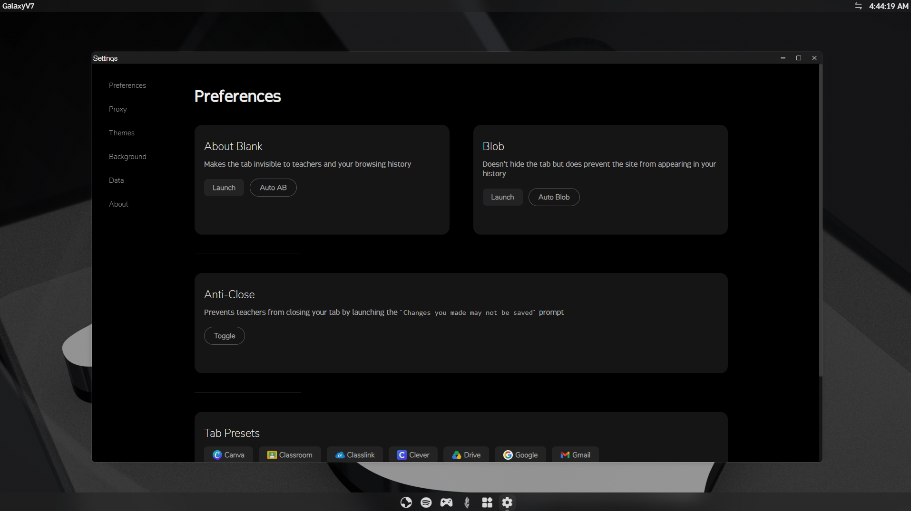

# Hopium

> Browse the internet with no restrictions.

Desktop UI: macOS-style menu bar, magnifying dock, Launchpad, Spotlight, Control Center and traffic-light windows with edge snapping. Customise it in Settings → Desktop & Dock. Ads are off by default (`ADS_ENABLED` in `src/lib/config.js`).

**Demo:** https://galxy.it.com/

## Run Galaxy Locally

### Prerequisites

- [Bun](https://bun.com/docs/installation)
- [Node.js](https://nodejs.org/en/download)

### Install Galaxy

```bash
git clone https://github.com/r480github/GalaxyV7
cd GalaxyV7
bun i
```

### Install Games (Optional)

```bash
cd static
git clone https://gitlab.com/Hydra.Network/game-assets/endis-assets books
cd ..
```

### Dev

```bash
bun run dev
```

Default port: `5173`

### Prod

```bash
bun run build
bun index.js
```

Default port: `5417`

## Don't have a server?

Galaxy can also be deployed statically with Netlify or other static deployers.
[GalaxyV7-Static](https://github.com/r480github/GalaxyV7-Static)


## A Look Inside

### OS



### Browser



### Settings




## Startup screen, widgets and Spotify HUD

Settings → **Desktop & Dock** has the startup screen (macOS / Windows / Auto / Off), glass blur and tint, and the widgets.
Settings → **Spotify** connects your account. Create an app in the Spotify developer dashboard, add the redirect address shown in
Settings (`https://your-site/spotify`, or `http://127.0.0.1:5173/spotify` locally; Spotify rejects `localhost`), and paste the Client ID.
Playback controls need Spotify Premium.
